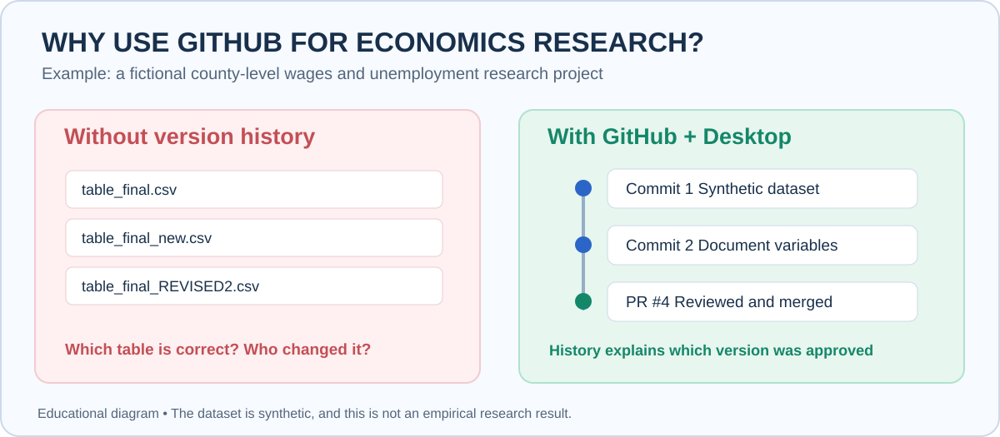
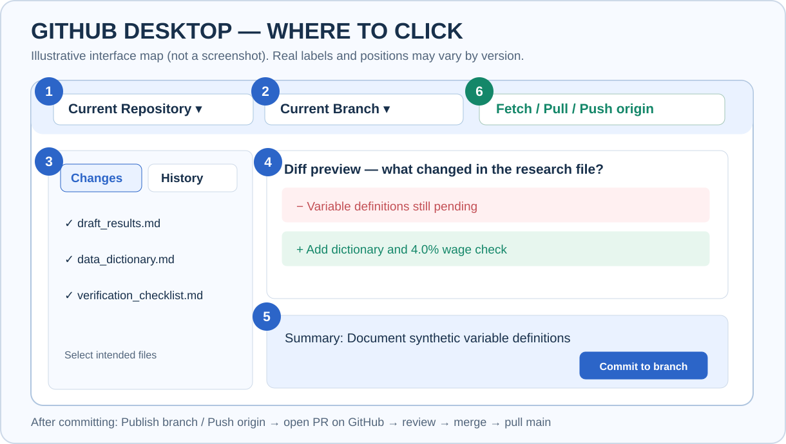
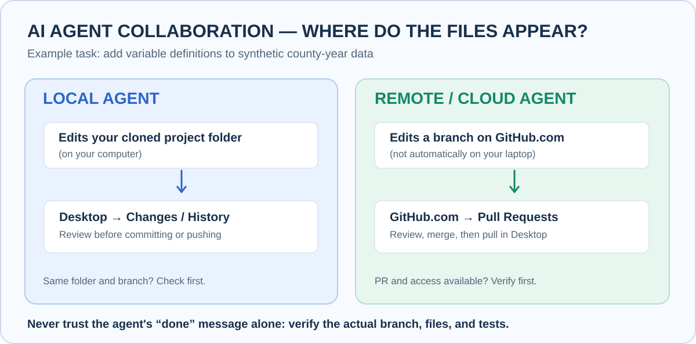

# Why Use GitHub? Learn With an Economics Research Example

**No command line.** This visual tutorial shows what GitHub is actually useful for when writing research papers, editing tables, keeping notebooks, and collaborating with human colleagues or AI agents.

The example is a **fictional economics project** using only [synthetic county-year data](../examples/economics/synthetic_county_panel.csv). It does not report real research findings or causal effects.

## 1. Why GitHub instead of saving ten copies of a file?

Imagine working on a paper called **Wages and Unemployment in Four Counties**. You update a descriptive result, your collaborator edits the definitions, and an AI agent helps revise documentation. After a week you might have:

```text
research_final.md
research_final_v2.md
research_final_v2_fixed.md
research_final_NEW.md
research_final_really_final.md
```

Which is right? What was changed, by whom, and why? Who approved the new table?



**With GitHub, one project has a history of named changes.** You can inspect an older version, see which lines changed, propose experiments on branches, and approve a change before it becomes the shared `main` version. A commit is a checkpoint, **not** a full backup policy, a scientific replication test, or a substitute for human review.

**When is GitHub worth using?** If you often revise research files, collaborate, use AI agents, or need an audit trail, it is useful. For a one-off private note with no collaborators, a normal folder may be simpler.

## 2. Who does what?

| Tool | Economics research example | Why it is useful |
|---|---|---|
| **GitHub.com** | Online copy of your research project; Issue and PR discussions | Everyone can inspect the accepted files and proposed changes |
| **GitHub Desktop** | Open local project, inspect changes, save commits, switch branches, sync | No command line required |
| **Editor** | Edit `.md`, `.csv`, `.tex`, `.py`, or `.R` files | This is where actual writing/analysis takes place |
| **Human collaborator** | Reviews interpretation or a new table | Confirms correctness before acceptance |
| **AI agent (optional)** | Drafts a dictionary, documentation or code on an authorized branch | Saves repetitive effort, but requires scoped permissions and review |

Do not put restricted participant data, student records, API keys, or confidential research material in a public repository or unapproved AI service. For large private datasets, GitHub often works best for **code, documentation and small public examples**, with restricted data stored separately.

## 3. Open the real teaching example

All GitHub records below actually exist. The economics project and observations are **fabricated solely for teaching**.

| Item | Open it | What it teaches |
|---|---|---|
| Initial dataset and draft | [Initial research commit](https://github.com/ningzhanglab/Github-for-Beginners/commit/ef5dc6484fa1b9027c1e28eed92f9d2a7fccf6b4) | **Commit / History:** exactly when first research files were saved |
| Question to solve | [Issue #3](https://github.com/ningzhanglab/Github-for-Beginners/issues/3) | **Issue:** define missing variable definitions as one actionable task |
| Proposed edits | [Pull Request #4 — Files changed](https://github.com/ningzhanglab/Github-for-Beginners/pull/4/files) | **Branch / Diff / Review:** what was added, deleted, or rewritten |
| Accepted version | [Current economics project](../examples/economics) | **Merge / main:** reviewed files become the main project version |

Follow this exact chain:


### A small but meaningful change

The first draft said the data were **missing definitions and checks**. In [PR #4](https://github.com/ningzhanglab/Github-for-Beginners/pull/4/files), we added a data dictionary and verified a simple calculation for county **Alpha**:

| Measure | 2024 | 2025 | Correct description |
|---|---:|---:|---|
| Fictional unemployment rate | 5.0% | 4.5% | Fell by **0.5 percentage points** |
| Fictional nominal wage | $25.00/hour | $26.00/hour | Grew by **4.0%** |

The wage calculation is `(26 / 25 − 1) × 100 = 4.0%`. There is **no regression, significance test, or causal estimate**. The practical lesson is that a collaborator can check a transparent change **before merging** rather than trusting a "fixed" file.

## 4. GitHub Desktop's important controls, by example



*Illustrated schematic — not an actual software screenshot. Official screenshots are available in [GitHub Desktop docs](https://docs.github.com/en/desktop/overview/creating-your-first-repository-using-github-desktop).*

| Number | GitHub Desktop control | When an economist uses it |
|---|---|---|
| **1** | **Current Repository** | Select the correct paper/replication package |
| **2** | **Current Branch** | Work on `robustness/new-specification` rather than changing `main` immediately |
| **3** | **Changes / History** | See what changed today, or inspect last week's accepted table |
| **4** | **Diff preview** | Check whether the agent deleted an important assumption or changed a coefficient |
| **5** | **Commit to [branch]** | Save a labeled checkpoint: "Document wage variable units" |
| **6** | **Fetch / Pull / Push origin** | Check online changes; download colleague's accepted edits; upload your commits |

**Three pairs learners often confuse:**

- **Commit vs Push:** Commit saves the checkpoint locally. Push sends local commits to GitHub.
- **Fetch vs Pull:** Fetch finds/downloads remote information. Pull integrates new remote commits into your selected local branch.
- **PR vs Merge:** A Pull Request *proposes* a change. Merge *accepts* it into another branch (typically `main`).

## 5. Step-by-step: copy the teaching project to your computer

1. Install [GitHub Desktop](https://desktop.github.com/) and sign in.
2. Open **File → Clone Repository…**. Use the URL `https://github.com/ningzhanglab/Github-for-Beginners`.
3. Choose a local folder; click **Clone**.
4. In Desktop click **Repository → Show in Finder** (Mac) or **Show in Explorer** (Windows).
5. Open `08_Live_Demo/econ-research-project/` to view the CSV, results, and research log.
6. In Desktop select **History** and click an earlier commit to inspect what files changed.
7. On GitHub.com, open **[PR #4 → Files changed](https://github.com/ningzhanglab/Github-for-Beginners/pull/4/files)** to see the exact proposed edits.
8. In Desktop choose **Current Branch → Pull Requests** if you want to examine a PR branch that is still open. Our example PR is **already merged**, so use its archived web diff and the History tab instead.

To practice modifying files, create **your own practice repository or fork** rather than pushing exercise commits into the shared tutorial repository.

## 6. Seven features explained as research problems

| Research problem | GitHub feature | Concrete example |
|---|---|---|
| "Which result was the version we submitted?" | **History / Commit** | Inspect the earlier [initial research commit](https://github.com/ningzhanglab/Github-for-Beginners/commit/ef5dc6484fa1b9027c1e28eed92f9d2a7fccf6b4) |
| "I want to test a new specification without breaking my paper." | **Branch** | Create `robustness/alternative-control` in Desktop |
| "My coauthor wants me to fix a missing variable definition." | **Issue** | [Issue #3](https://github.com/ningzhanglab/Github-for-Beginners/issues/3) sets clear acceptance criteria |
| "What exactly did an assistant change?" | **Diff** | [PR #4 → Files changed](https://github.com/ningzhanglab/Github-for-Beginners/pull/4/files) shows added lines |
| "Should we accept that change?" | **Pull Request + Review** | Compare the proposal and confirm variable units |
| "The coauthor merged it; why do I still see old files?" | **Fetch + Pull** | In Desktop select `main`, Fetch origin, then Pull origin |
| "We made a bad shared change. Can we correct it?" | **History + Revert** | Inspect the commit and make a *new* reversing commit, when appropriate |

Other useful features: **README** describes the project; **Issues** track tasks; **PR templates** standardize reviews; **Release tags** can label a submission version (optional, not essential to start).

## 7. Working with an agent



**Local agent:** it edits the same folder you opened in Desktop. Review **Changes** and **History**. If it already committed, you may need to inspect History instead of Changes.

**Cloud or connected agent:** it may commit to an online branch and open a PR. Check **GitHub.com → Pull requests**. After the PR is reviewed and merged, use Desktop `main` → **Fetch** → **Pull**.

**A scoped agent task you can copy:**

> In my economics research repository, add a `data_dictionary.md` explaining units and variable definitions. Only edit that file and the README links. Work on a new `agent/data-dictionary` branch, never directly on `main`. Keep all data values unchanged. Check relative links, disclose what was not tested, and open a draft PR if you have authorized GitHub access. Do not merge it.

See the [Economics Research + Agent Walkthrough](../04_Practice/Economics_AI_Example.md) for a deeper example.

## 8. Try it yourself

- **10 minutes:** Read [Issue #3](https://github.com/ningzhanglab/Github-for-Beginners/issues/3) and inspect [PR #4](https://github.com/ningzhanglab/Github-for-Beginners/pull/4/files).
- **15 minutes:** In your own repo, create a branch and edit one fake result table.
- **20 minutes:** Ask an agent to review the table units on a separate branch and check the diff.
- **After merge:** pull the accepted branch locally and compare it with your starting file.

Next lessons: [Feature Tour for Economists](../04_Practice/Economics_Examples.md) · [First 15 Minutes](First_15_Minutes.md) · [Recovery Guide](../05_Help/Fix_Problems.md).

*Official reference: [GitHub Desktop overview](https://docs.github.com/en/desktop), [Branches](https://docs.github.com/en/desktop/making-changes-in-a-branch/managing-branches-in-github-desktop), [Pull request viewing](https://docs.github.com/en/desktop/working-with-your-remote-repository-on-github-or-github-enterprise/viewing-a-pull-request-in-github-desktop).*