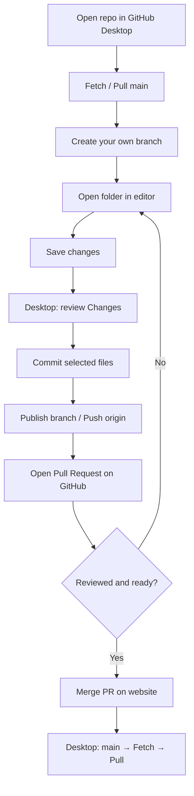
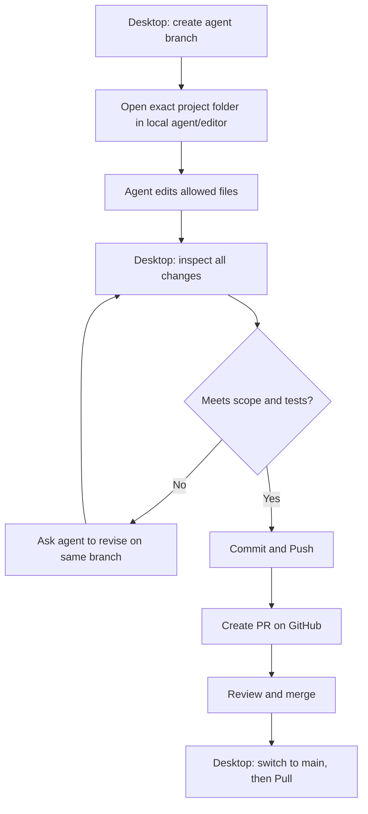
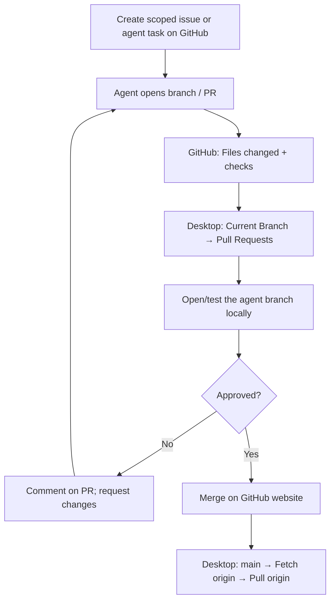

# Visual Workflows: What Happens Next?

These diagrams explain **what to click and in what order**, using GitHub Desktop and the GitHub website. No terminal.

## Workflow A: you edit locally

**Remember:** the editor writes files; Desktop tracks and syncs; GitHub website handles collaboration and PR approval.

## Workflow B: an agent edits your local folder

**Check:** for a local agent, files usually appear in Desktop's **Changes** panel before you commit. The agent could commit autonomously if you grant that permission—then inspect **History** too.

## Workflow C: a cloud agent changes GitHub remotely

A remote agent's work does not immediately appear in your local folder. **Sync is a separate action**.

## The buttons are different

| Button | Plain-English meaning | Typical moment |
|---|---|---|
| Clone | Make a connected local copy | First time opening a remote project |
| New Branch | Give the task a safe workspace | Before editing |
| Commit to … | Save a selected local checkpoint | After inspecting changed files |
| Publish branch | Make a brand-new local branch visible online | First upload of that branch |
| Push origin | Upload your local commits | After committing |
| Fetch origin | Check what is new online | Before pulling or reviewing remote work |
| Pull origin | Download and integrate remote commits into current local branch | After merge or when online work changed |
| Preview Pull Request | Compare and propose branch changes | Before review/merge |

## Which state are you in?

| Situation | Do this first |
|---|---|
| Only want to read files | Open GitHub.com; cloning optional |
| Want to make changes on your computer | Clone once, create branch |
| Changes are shown in Desktop | Inspect, commit, then push |
| PR is open but not merged | Review the PR branch; do not assume `main` changed |
| PR merged online | Switch to `main` in Desktop, fetch, pull |
| Agent is running locally in your folder | Watch Desktop **Changes** / **History** |
| Two contributors edited the same file | Pause, sync, resolve conflict deliberately |

Read: [Beginner Handbook](Desktop_Guide.md) · [Cloud Agent Workflow](../03_Work_With_AI/Cloud_Agent.md).