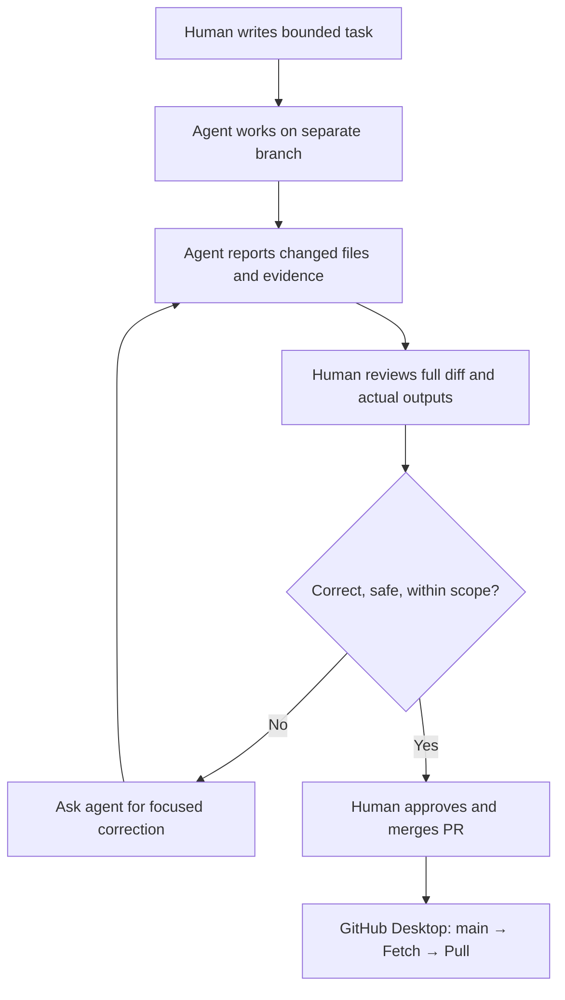

# How to Collaborate With an AI Agent Using GitHub Desktop

For a concrete research example, follow [Agent Reviews an Economics Dataset](../07_Econ_Research/Econ_Agent_Workflow.md), including a real GitHub Issue and reviewed Pull Request using synthetic values.

**Audience:** people who want AI help on an existing GitHub project, without typing Git commands.

The central idea is simple: **the agent proposes or edits on a controlled workspace; you verify the result before it becomes part of the shared project.**

## Start with the right model

Not all agents can write files. Choose the workflow based on where your agent actually runs and what permissions it has.

| Model | Where agent works | How you see changes | How to collaborate |
|---|---|---|---|
| **A. Advice-only chat** | Chat messages only | Text the agent returns | You paste/apply changes in editor → Desktop commits |
| **B. Local file agent** | Your local project folder/editor | Desktop **Changes** or **History** | Desktop branch → agent edits → inspect → commit/push → PR |
| **C. Cloud GitHub agent** | A connected GitHub repository/remote branch | GitHub **Pull requests** | Issue/task → agent PR → review → merge → Desktop pulls |
| **D. Connected chat agent** | Depends on the authorized integration and tool | Tool-reported file commits, branch, or PR links | Ask for bounded work, verify the **actual repository state**, not chat claims |

**GitHub Desktop does not host an agent.** You use Desktop to control and inspect local files while a separate agent is responsible for proposed work. For GitHub-native Copilot cloud-agent features, availability depends on subscription, repository access, and settings. Other services have different capabilities.

## The recommended collaboration contract

Define these before running an agent:

| Field | Example |
|---|---|
| Repository | `owner/project` |
| Task | Add a short beginner tutorial explaining what Commit and Push do |
| Branch | `agent/explain-commit-push` |
| Allowed files | `docs/...`, `README.md` |
| Forbidden files | `data/`, `secrets/`, `main`, unrelated course assignments |
| Acceptance criteria | Links work; examples are correct; no command-line steps |
| Verification | List files changed; show PR link; note tests performed and limitations |
| Stop rule | If you need to change files outside scope, stop and request approval |

**Small tasks and separate branches are safer than "rewrite my whole repository".**

## Before giving an agent access

1. Decide whether you actually need write access. For planning or review, read-only access may be enough.
2. Select only the intended repository if the platform supports repository-scoped permissions.
3. Do not make private or restricted data accessible to unapproved AI services.
4. If this is a group repo, agree on who is allowed to merge PRs and modify protected files.
5. Use a new branch, draft PR, or another isolated workspace. Do not give a beginner's first agent unrestricted permission to replace `main`.

## The complete approval workflow

### What to review—not just what to read in the agent's message

- **Scope:** every changed/deleted/renamed file belongs to the task.
- **Correctness:** open the final document/site/output; run available tests if relevant.
- **Assumptions:** are sources current, ambiguous terms labeled, and missing data left unresolved?
- **Risk:** secrets, licenses, large deletions, changed dependencies, broken paths.
- **Reproducibility:** was the requested branch/commit/PR actually created?
- **Handoff:** agent leaves clear notes about what is complete, partial, unverified.

A successful commit is not the same as a passed test. A passing test does not guarantee the result meets the user's requirements.

## Two preferred routes

**If you have a local AI editor/agent:** read [Local Agent Workflow](Local_Agent_Workflow.md). It explains opening the exact folder, preparing a branch in Desktop, inspecting the modifications and keeping your `main` stable.

**If the agent is connected to GitHub:** read [Cloud Agent Workflow](Cloud_Agent_Workflow.md). It explains GitHub Issues, an agent PR, inspecting the PR in Desktop, reviewing/merging on the website, and syncing locally.

If your chat assistant cannot reach or write to the repository, use it for a copy-paste instruction or patch and apply the change manually with your editor.

## Examples from actual research/project maintenance

- **Documentation:** agent drafts a new setup guide; human verifies it in GitHub's Markdown preview.
- **Data collection:** agent adds one school record with source links; human checks schema, citations and unintended changes.
- **Homework/project:** agent proposes a test or review note; human verifies academic integrity requirements and explains their own reasoning.
- **Website:** agent edits one page on a branch; human previews the site and reviews the diff before merge.

## A practical default prompt

> Work in `owner/project` on a **new branch** named `agent/short-task-name`. Only edit `docs/` and `README.md`. Do not modify `main`, delete unrelated files, or change repository settings. First inspect the existing structure; then implement the smallest correct change. Provide a list of modified files, what you verified, what remains unverified, and a PR link if your tools support opening one. Stop and ask before expanding scope.

For variants and ready-made copy/paste prompts, see [Prompt Library](Prompt_Library.md).

## What about reviewing an agent's code without touching it?

The easiest path is **PR → Files changed** on GitHub.com. In Desktop, choose **Current Branch → Pull Requests**, select the agent PR, and open its branch to read the files or run the project locally. Comments and final merges happen on GitHub.com.

## Troubleshooting short answers

**Agent says it committed but I see nothing.** Ask for the exact repo, branch, commit SHA and URL; verify them. Local edits appear in Desktop Changes/History. Remote edits appear on GitHub and must be fetched/checked out.

**Both of us are editing the same branch.** Pause one editor. Have the agent finish or stop, checkpoint the work, sync and coordinate the next task. Prefer distinct branches/worktrees for parallel work.

**Agent asked to force push or delete `main`.** Do not approve as a normal beginner workflow. Ask for a branch + PR instead.

**Relevant official resources:** [GitHub Desktop PRs](https://docs.github.com/en/desktop/working-with-your-remote-repository-on-github-or-github-enterprise/viewing-a-pull-request-in-github-desktop) · [GitHub Copilot cloud agent](https://docs.github.com/en/copilot/how-tos/copilot-on-github/use-copilot-agents/overview).