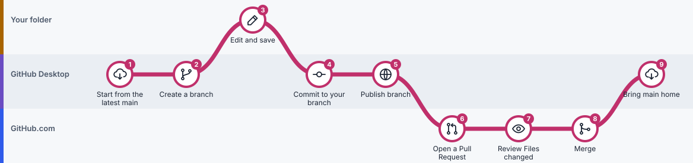

# GitHub for Beginners

**Learn GitHub on one page.** Keep versions of your work, collaborate with coauthors, and check what an AI assistant changed, using the free GitHub Desktop app. No coding, no terminal.

## 👉 [Open the guide](https://ningzhanglab.github.io/Github-for-Beginners/)

Everything is on that one page: eight short lessons in order, with an icon for every step and a picture of every workflow. Just scroll. Tick each lesson when you finish it, and the page remembers where you are.

*Every workflow is drawn like this: each circle is a step, placed in the band where it happens. Amber is your project folder, violet is GitHub Desktop, blue is GitHub.com.*

> **Link not opening?** The website may not be switched on yet ([how to switch it on](INTERACTIVE_COURSE_SETUP.md)). You can also download [`index.html`](index.html) (choose **Download raw file**) and double-click it: the whole guide is in that one file and works offline. Or read the same lessons right here on GitHub, starting with [Lesson 1](lessons/01-what-is-github.md).

## What you'll learn

| | Lesson | Time |
|---|---|---|
|  | 1. What is GitHub? | 10 min |
|  | 2. Get set up | 10 min |
|  | 3. Your first project | 15 min |
|  | 4. Save and sync every day | 10 min |
|  | 5. Branches and pull requests | 20 min |
|  | 6. Work with other people | 20 min |
|  | 7. Work with an AI assistant | 20 min |
|  | 8. Fix mistakes | 15 min |

Plus practice labs, a cheat sheet, a dictionary and ready-made AI instructions, all on the same page. Lessons 1 to 4 are enough for a personal project.

Want to practise clicking first? The [Desktop simulator](https://ningzhanglab.github.io/Github-for-Beginners/course.html) is a safe, pretend GitHub Desktop.

## A real example

This repository contains a fictional economics project with real GitHub records: [Issue #3](https://github.com/ningzhanglab/Github-for-Beginners/issues/3) asked for variable definitions, and [Pull Request #4](https://github.com/ningzhanglab/Github-for-Beginners/pull/4/files) proposed them for review before they were accepted. The files are in [examples/economics](examples/economics/README.md). The counties and numbers are invented.

## For maintainers

| File or folder | What it is |
|---|---|
| [`index.html`](index.html) | **The guide.** One self-contained page, generated from `lessons/` |
| [`lessons/`](lessons/README.md) | The lessons in Markdown. **Edit these** to change the guide |
| [`course.html`](course.html) | The optional Desktop simulator |
| [`tools/`](tools/) | Builds `index.html`, the icons and the route pictures |
| [`assets/`](assets/) | Icons, route pictures and illustrations |
| [`examples/`](examples/README.md) | The fictional example projects |
| `01_Start_Here/` … `05_Help/` | Old pages, kept only so old links still work |
| [`AGENTS.md`](AGENTS.md) | Rules for AI assistants that edit this repository |

How to publish and update the guide: [INTERACTIVE_COURSE_SETUP.md](INTERACTIVE_COURSE_SETUP.md).

*This guide teaches GitHub Desktop, not Git commands. Pictures are illustrations, and exact button positions can change; see the [official GitHub Desktop documentation](https://docs.github.com/en/desktop).*
