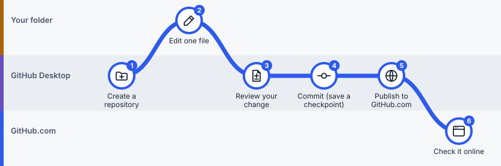

# Lesson 3: Your first project

> **You'll learn:** to create a project, change one file, save a checkpoint, and see it online. This is the whole GitHub idea in six steps.
> **Time:** 15 minutes. **You need:** [Lesson 2](02-get-set-up.md) done.



*The route for this lesson. Follow the line: it starts in GitHub Desktop, visits your folder to edit a file, and ends on GitHub.com.*

>  **Practise on your own new project**, not on someone else's shared project. Then nothing you try can affect anyone else.

## Steps

###  Step 1: Create a repository

 **In GitHub Desktop**

**Do this:** choose **File → New repository…** and fill in:

| Field | Type or choose |
|---|---|
| Name | `my-first-notes` |
| Description | `My practice project` |
| Local path | A folder you'll remember, such as Documents |
| Initialize this repository with a README | **Tick it** |
| Git ignore, License | Leave as they are |

Click **Create repository**.

**You'll see:** `my-first-notes` under **Current Repository** at the top left. The **Changes** tab says there are no local changes.


*Simplified drawing, not a screenshot. Buttons may sit in slightly different places in your version.*

###  Step 2: Edit one file

 **In your project folder**

**Do this:** choose **Repository → Show in Finder** (Mac) or **Repository → Show in Explorer** (Windows). Open `README.md` in your text editor, replace its text with this, and **save**:

```markdown
# My First Notes

This is my practice project.

- Today I learned how to save a checkpoint.
- Next I want to try a branch.
```

**You'll see:** nothing changes in GitHub Desktop until you save.

>  **Watch out:** Edit the file inside the folder Desktop just opened, not a copy in Downloads.

###  Step 3: Review your change

 **In GitHub Desktop**

**Do this:** go back to GitHub Desktop. Click the **Changes** tab, then click `README.md`.

**You'll see:** added lines in green with a **+**, removed lines in red with a **−**. This view is called the **diff**.

>  **Watch out:** File not listed? You probably haven't saved yet, or you saved it somewhere else.

###  Step 4: Commit (save a checkpoint)

 **In GitHub Desktop**

**Do this:** in the **Summary** box at the bottom left, type `Add my first notes`. Click **Commit to main**.

**You'll see:** the Changes list empties. Your checkpoint appears in the **History** tab.

>  **Watch out:** The checkpoint is saved on your computer only. It isn't online yet.

###  Step 5: Publish to GitHub.com

 **In GitHub Desktop**

**Do this:** click **Publish repository** in the top bar. Leave **Keep this code private** ticked. Click **Publish repository**.

**You'll see:** the top-bar button changes to **Fetch origin**. That means your project is now connected to GitHub.com.

>  **Watch out:** A public project can be seen by anyone on the internet. Keep practice projects private.

###  Step 6: Check it online

 **On GitHub.com**

**Do this:** choose **Repository → View on GitHub**.

**You'll see:** your browser shows `my-first-notes` with the text you wrote.

## You did it

You've used all three places: you **edited** in your folder, **committed and published** in GitHub Desktop, and **checked** on GitHub.com. Every other workflow in this guide is a variation of this one.

## Check yourself

<details><summary>What's the difference between the Changes tab and the History tab?</summary>

**Changes** shows edits you haven't committed yet. **History** shows checkpoints you've already committed.
</details>

<details><summary>You make a second edit tomorrow. Which buttons do you use?</summary>

Save the file, then in Desktop: review **Changes**, **Commit to main**, then **Push origin**. ([Lesson 4](04-save-and-sync.md) covers this.)
</details>

## Try it in the simulator

Want to rehearse before touching the real app? The [interactive course](https://ningzhanglab.github.io/Github-for-Beginners/course.html) lets you click through these same steps on a safe, pretend version of GitHub Desktop.

---

**Next:** [Lesson 4: Save and sync every day](04-save-and-sync.md) · [Previous: Lesson 2](02-get-set-up.md) · [All lessons](README.md)

*Steps follow GitHub's [official first-repository guide](https://docs.github.com/en/desktop/overview/creating-your-first-repository-using-github-desktop). Labels can vary slightly between app versions.*
