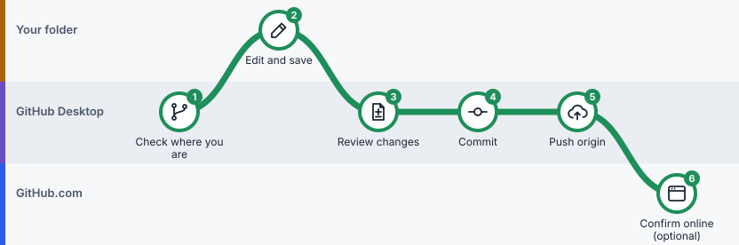
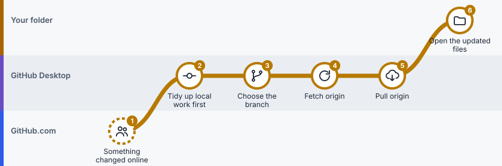

# Lesson 4: Save and sync every day

> **You'll learn:** the two routines you'll use most: sending your changes up, and bringing other people's changes down.
> **Time:** 10 minutes. **You need:** a published project from [Lesson 3](03-your-first-project.md).

## Part A: Send your changes up

*Your everyday routine: edit in your folder, commit and push in Desktop. Click the picture to step through it on the route map.*

###  Step 1: Check where you are

 **In GitHub Desktop**

**Do this:** look at the top bar: **Current Repository** and **Current Branch**.

**You'll see:** your project name and a branch name, usually `main`.

>  **Watch out:** Most "where did my file go?" moments start with the wrong project or branch selected.

###  Step 2: Edit and save

 **In your project folder**

**Do this:** open the project (**Repository → Open in** *your editor*, or **Show in Finder / Show in Explorer**), make your change, and save.

###  Step 3: Review your changes

 **In GitHub Desktop**

**Do this:** click **Changes**. Read each file's diff. Untick any file you don't want in this checkpoint.

**You'll see:** only ticked files go into the commit.

>  **Watch out:** Look for surprises: deleted files, files you didn't mean to touch, or passwords.

###  Step 4: Commit

 **In GitHub Desktop**

**Do this:** write a Summary that says what changed, for example `Clarify wage units in table 1`, and click **Commit to main**.

**You'll see:** the top bar now shows **Push origin** with a small number: the checkpoints waiting to upload.

###  Step 5: Push origin

 **In GitHub Desktop**

**Do this:** click **Push origin**.

**You'll see:** the number disappears. Your checkpoint is on GitHub.com.

###  Step 6: Confirm online (optional)

 **On GitHub.com**

**Do this:** **Repository → View on GitHub**, then refresh.

>  **Watch out:** Still old? Check the branch selector on the website matches the branch you pushed.

## Part B: Bring other people's changes down

*When the online copy changed, the route goes the other way: from GitHub.com, through Desktop, into your folder. Click the picture to step through it on the route map.*

Your folder **does not update by itself**. When a coauthor, an AI assistant, or you on another computer changes the project online, you bring it down like this:

###  Step 1: Finish your own edits first

 **In GitHub Desktop**

**Do this:** look at **Changes**. If you have unfinished edits, commit them before you continue.

>  **Watch out:** Never click **Discard changes** just to make a message go away. It deletes unsaved work.

###  Step 2: Choose the branch

 **In GitHub Desktop**

**Do this:** **Current Branch → main** (or whichever branch changed).

###  Step 3: Fetch origin

 **In GitHub Desktop**

**Do this:** click **Fetch origin**.

**You'll see:** if there's anything new, the button becomes **Pull origin** with a number.

**Fetch only looks.** It doesn't change your files yet.

###  Step 4: Pull origin

 **In GitHub Desktop**

**Do this:** click **Pull origin**.

**You'll see:** new checkpoints in **History**, and updated files in your folder.

>  **Watch out:** If Desktop says there's a conflict, stop and read [Lesson 8](08-fix-mistakes.md).

## Looking back in time

###  Use History to see older versions

 **In GitHub Desktop**

**Do this:** click the **History** tab, then click any checkpoint.

**You'll see:** who saved it, when, the Summary, and exactly which lines changed.

This is how you answer "which version of table 2 did we submit?" without filenames like `table2_final_v3`.

## The two-line summary

| | When | Click |
|---|---|---|
|  | **You** changed something | Commit → **Push origin** |
|  | **Someone else** changed something | **Fetch origin** → **Pull origin** |

## Check yourself

What's the difference between Fetch and Pull?

**Fetch** checks GitHub.com for anything new. **Pull** actually brings it into your folder.

You pushed, but the website shows the old file. What do you check?

That the website is showing the same branch you pushed, and that you refreshed the page.

---

**Next:** [Lesson 5: Branches and pull requests](05-branches-and-pull-requests.md) · [Previous: Lesson 3](03-your-first-project.md) · [All lessons](README.md)
