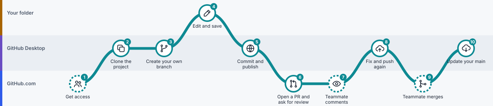
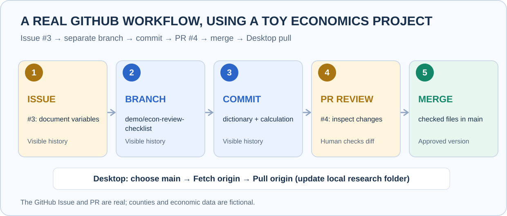

# Lesson 6: Work with other people

> **You'll learn:** how to join a coauthor's project, write tasks as Issues, and get your work reviewed.
> **Time:** 20 minutes. **You need:** [Lesson 5](05-branches-and-pull-requests.md), and a coauthor's project (or a friend willing to try).

*The route for joining someone's project. Dashed stations are steps your teammate does.*

## Steps

###  Step 1: Get access

 **Done by your teammate, on GitHub.com**

**Do this:** ask the project's owner to add you. On GitHub.com they open the project's **Settings → Collaborators**, click **Add people** and type your username. You accept the invitation from your email or from GitHub notifications.

**You'll see:** the project in your list on GitHub.com.

>  **Watch out:** Without access you can still read and copy a public project, but you can't upload to it.

###  Step 2: Clone the project

 **In GitHub Desktop**

**Do this:** **File → Clone repository…**, choose the **GitHub.com** tab, select the project, pick a local folder, and click **Clone**.

**You'll see:** a connected copy of the project in your folder, and its name under **Current Repository**.

>  **Watch out:** Clone once. Afterwards, use **Fetch** and **Pull** to get updates. Don't use **Download ZIP**: a ZIP copy isn't connected and can't sync.

###  Step 3: Create your own branch

 **In GitHub Desktop**

**Do this:** **Current Branch → New branch**, for example `docs/fix-variable-definitions`.

###  Step 4: Edit and save

 **In your project folder**

**Do this:** make your change in your editor and save.

###  Step 5: Commit and publish

 **In GitHub Desktop**

**Do this:** review **Changes**, click **Commit to** *your branch*, then **Publish branch**.

###  Step 6: Open a pull request and ask for a review

 **On GitHub.com**

**Do this:** **Preview Pull Request → Create pull request**. On the pull request page, use **Reviewers** on the right to request your teammate.

**You'll see:** your teammate gets a notification.

###  Step 7: Your teammate comments

 **Done by your teammate, on GitHub.com**

**Do this:** nothing. Your teammate reads **Files changed** and comments, approves or requests changes.

###  Step 8: Fix and push again

 **In GitHub Desktop**

**Do this:** stay on the **same branch**. Edit, commit, and click **Push origin**.

**You'll see:** the same pull request updates automatically. Don't open a new one.

###  Step 9: Your teammate merges

 **Done by your teammate, on GitHub.com**

**Do this:** when you both agree, the owner clicks **Merge pull request**.

###  Step 10: Update your main

 **In GitHub Desktop**

**Do this:** **Current Branch → main**, **Fetch origin**, **Pull origin**.

## Write tasks as Issues

###  An Issue is a written to-do on GitHub.com

 **On GitHub.com**

Instead of an email saying "please fix the dataset", open the project's **Issues** tab, click **New issue**, and write:

- **What's needed:** "Say whether the unemployment change is in percent or percentage points."
- **Which files:** `draft_results.md` only.
- **How we'll know it's done:** the table says "percentage points" and the arithmetic is shown.

Everyone can see the task, discuss it in one place, and link the pull request that fixes it. **A real example:** [Issue #3](https://github.com/ningzhanglab/Github-for-Beginners/issues/3) led to [Pull Request #4](https://github.com/ningzhanglab/Github-for-Beginners/pull/4).

## Good habits for shared projects

| | Habit | Why |
|---|---|---|
|  | **Pull before you start** | You begin from everyone's latest work |
|  | **One branch per task** | Reviews stay small and clear |
|  | **Small, clearly named commits** | History explains itself: "Fix wage units", not "stuff" |
|  | **Nobody merges their own work unreviewed** | A second pair of eyes catches mistakes |
|  | **Two people editing the same paragraph?** Talk first | Overlapping edits cause conflicts ([Lesson 8](08-fix-mistakes.md)) |

## Check yourself

Your teammate asked for changes. Do you open a new pull request?

No. Push new commits to the **same branch**; the existing pull request updates by itself.

Why clone instead of downloading a ZIP?

A clone stays connected to GitHub.com, so you can Push and Pull. A ZIP is a disconnected copy.

---

**Next:** [Lesson 7: Work with an AI assistant](07-work-with-ai.md) · [Previous: Lesson 5](05-branches-and-pull-requests.md) · [All lessons](README.md)
