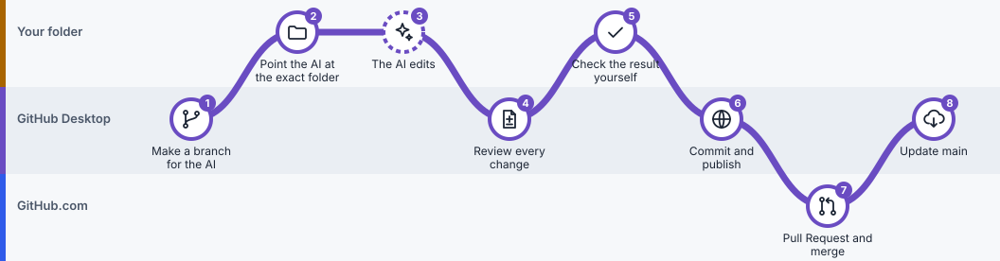
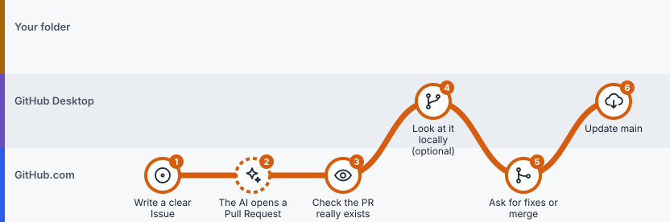

# Lesson 7: Work with an AI assistant

> **You'll learn:** how to let an AI assistant help with your project while you stay in control of what's accepted.
> **Time:** 20 minutes. **You need:** [Lesson 5](05-branches-and-pull-requests.md) (branches and pull requests).

## The one idea

**The AI proposes; you review; you decide.** Treat an AI assistant like a new coauthor: give it a small, clear task, keep its work on a separate branch, and read every change before you accept it.

## Which kind of assistant do you have?

| | Your assistant… | Where its work appears | Follow |
|---|---|---|---|
|  | Can **only chat** | Nowhere, until you paste its text into a file yourself | Part C |
|  | Edits files **on your computer** (for example, an AI-enabled editor) | GitHub Desktop **Changes** | Part A |
|  | Works **on GitHub.com** and opens pull requests | A **pull request** on GitHub.com | Part B |

Not sure? Ask it: "Can you edit files in my project, and where?" If it can't show you a changed file or a pull request link, treat it as chat-only.

## Part A: An assistant that edits your folder

*Local AI route. The dashed station is the step the AI does; every other step is you checking and accepting. Click the picture to step through it on the route map.*

###  Step 1: Make a branch for the AI

 **In GitHub Desktop**

**Do this:** pull the latest `main`, then **Current Branch → New branch**, for example `agent/data-dictionary`.

**You'll see:** `main` is now protected from the AI's edits.

###  Step 2: Point the AI at the exact folder and give a small task

 **In your project folder**

**Do this:** use **Repository → Show in Finder / Show in Explorer** to find the folder, and open that same folder in your AI tool. Then give it a task with clear limits (see the instruction to copy, below).

>  **Watch out:** Ask the AI to tell you its folder and branch before it edits. If it names a different folder, stop: it's working on another copy.

###  Step 3: The AI edits

 **Done by the AI assistant**

**Do this:** let it work. Ask it **not** to commit or push, so you can review first.

###  Step 4: Review every change

 **In GitHub Desktop**

**Do this:** open **Changes** and click through every file.

**You'll see:** only the files you allowed.

>  **Watch out:** Look for deleted files, renamed files, changed data, or numbers it invented. If the AI already committed, look in **History** instead.

###  Step 5: Check the result yourself

 **In your project folder**

**Do this:** open the edited file and read it. Recheck any numbers and click any links.

>  **Watch out:** "Done" from an AI is a claim, not proof.

###  Step 6: Commit, publish, and accept through a pull request

 **In GitHub Desktop**

**Do this:** **Commit to agent/data-dictionary**, **Publish branch**, then **Preview Pull Request → Create pull request**. Read **Files changed** once more, merge, and pull `main` (as in [Lesson 5](05-branches-and-pull-requests.md)).

## Part B: An assistant that works on GitHub.com

*Cloud AI route. Almost everything happens on GitHub.com; your folder only changes when you pull at the end. Click the picture to step through it on the route map.*

Some assistants connect to GitHub and open pull requests by themselves. What's available depends on the product, your plan and the project's permissions.

###  Step 1: Write a clear Issue

 **On GitHub.com**

**Do this:** **Issues → New issue**. Describe one goal, which files it may change, what it must not change (for example the data file and `main`), and how you'll check the result.

###  Step 2: The AI opens a pull request

 **Done by the AI assistant**

**Do this:** assign the Issue to the AI if your service supports that, or ask your connected assistant to work on a new branch and open a **draft pull request**.

>  **Watch out:** Never ask an AI to merge its own work or to change `main` directly.

###  Step 3: Check the pull request really exists

 **On GitHub.com**

**Do this:** open **Pull requests**, find it, and read **Files changed** for every file.

>  **Watch out:** No pull request link means nothing to review yet, whatever the chat says.

###  Step 4: Look at it on your computer (optional)

 **In GitHub Desktop**

**Do this:** in Desktop, **Current Branch → Pull Requests**, pick the AI's pull request, and open the files in your editor.

###  Step 5: Ask for fixes, or merge

 **On GitHub.com**

**Do this:** comment with exact file names and what to change. When it's right, **Merge pull request**.

###  Step 6: Update your folder

 **In GitHub Desktop**

**Do this:** **Current Branch → main**, **Fetch origin**, **Pull origin**. The AI's work never appears in your folder until you pull.

## Part C: A chat-only assistant

###  Paste, review, commit

 **In your project folder**

**Do this:** ask for the text, paste it into your file, save, then review it in Desktop's **Changes** and commit it yourself, exactly as in [Lesson 4](04-save-and-sync.md).

## An instruction you can copy

> Please add a short data dictionary explaining my variables and their units. **Only edit `data_dictionary.md`. Do not change the CSV or `main`.** Work on the branch `agent/data-dictionary` if you can edit files. Tell me exactly which files you changed and what you checked. **Do not merge anything.** If you can't edit files, give me the text to paste myself.

More ready-made instructions: [AI prompt library](ai-prompts.md).

## Before you merge an AI's work

| | Check | Look at |
|---|---|---|
|  | Only the files you allowed changed | Desktop **Changes**, or **Files changed** on the PR |
|  | Nothing important was deleted or renamed | The file list in the diff |
|  | The numbers and facts are right | Open the files and recheck them yourself |
|  | No passwords or private data were added | The diff |
|  | You, not the AI, click Merge | The pull request page |

## A real example

In this repository, [Issue #3](https://github.com/ningzhanglab/Github-for-Beginners/issues/3) asked for variable definitions and a check of two calculations in a made-up economics dataset. An AI assistant (ChatGPT, using authorized GitHub tools) opened [Pull Request #4](https://github.com/ningzhanglab/Github-for-Beginners/pull/4/files), which a human reviewed and merged. Notice in **Files changed** that four documentation files changed and the data file did not, and that the results describe 5.0% → 4.5% as **0.5 percentage points**, not 0.5%.

## Check yourself

The AI says "All done!" but Desktop shows no changes. What now?

Ask for evidence: which folder, which branch, which pull request link. A cloud assistant's work appears as a pull request on GitHub.com, not in your folder.

---

**Next:** [Lesson 8: Fix mistakes](08-fix-mistakes.md) · [Previous: Lesson 6](06-work-with-other-people.md) · [All lessons](README.md)
