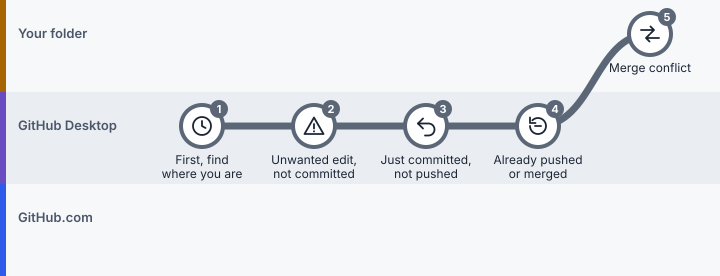

# Lesson 8: Fix mistakes

> **You'll learn:** how to undo safely at each stage, and what to check when something looks missing.
> **Time:** 15 minutes. **Use it:** whenever something goes wrong.

**First rule:** don't panic-click **Discard**, delete branches, or follow advice to "force push". Find out where you are first.

*The recovery route. Work down it and stop at the first step that matches your situation. Click the picture to step through it on the route map.*

## Steps

###  Step 1: Find out where you are

 **In GitHub Desktop**

**Do this:** check **Current Repository**, **Current Branch**, the **Changes** tab and the **History** tab.

**You'll see:** whether your change is unsaved (in Changes), committed (in History), pushed (no Push origin number), or merged (on GitHub.com).

>  **Watch out:** Many "lost" files are just on another branch. Switch back before assuming anything was deleted.

###  Step 2: An unwanted edit you haven't committed

 **In GitHub Desktop**

**Do this:** in **Changes**, click the file and read what would be lost. Copy anything you want to keep. Then right-click the file and choose **Discard changes…**

**You'll see:** the file returns to its last checkpoint.

>  **Watch out:** Discarding can't easily be undone. If you're unsure, copy the whole folder somewhere safe first.

###  Step 3: You just committed, but haven't pushed

 **In GitHub Desktop**

**Do this:** right after committing, GitHub Desktop shows an **Undo** button below the commit box. Click it.

**You'll see:** your edits are back in **Changes**, uncommitted, ready to fix.

>  **Watch out:** Only undo checkpoints you haven't pushed.

###  Step 4: The mistake is already pushed or merged

 **In GitHub Desktop**

**Do this:** in **History**, right-click the commit and choose **Revert changes in commit**. Then click **Push origin**.

**You'll see:** a new checkpoint that cancels the old one. The history stays honest: everyone can see what happened and why.

>  **Watch out:** Never force-push or delete shared branches to hide a mistake.

###  Step 5: Two edits clash (merge conflict)

 **In your project folder**

**Do this:** if Desktop lists conflicted files, click **Open in** *your editor*. You'll see both versions between marker lines like `<<<<<<<`, `=======` and `>>>>>>>`. Keep the right text, delete the marker lines, and save. Back in Desktop, click **Continue merge**.

**You'll see:** the conflict list empties and the merge finishes.

>  **Watch out:** Don't assume your version (or the AI's) should win. Ask the person who wrote the other version.

## "I can't see my changes"

| | What you see | Most likely reason | Do this |
|---|---|---|---|
|  | GitHub.com shows the old file | You committed but didn't push, or you're viewing another branch | **Push origin**; check the branch selector on the website |
|  | Your folder shows the old file | Someone changed it online | **Fetch origin → Pull origin** on the right branch |
|  | An AI says it finished, but nothing changed | It worked on GitHub.com, or on a different folder | Ask for the pull request link or the folder path |
|  | Files "disappeared" after switching branches | That branch has a different version | Switch back with **Current Branch** |
|  | Desktop doesn't know about your folder | It's a ZIP download, not a clone | **File → Clone repository…** once, then work there |

## "Push was rejected" or "permission denied"

- Check you're signed into the right account (Desktop settings → **Accounts**).
- You may not have write access. Ask the owner, or open a pull request instead.
- The online branch may have newer commits. Click **Fetch origin**, then **Pull origin**, then push again.
- A very large file can be refused. Keep big datasets outside the repository.

## Before you share anything

| | Check |
|---|---|
|  | No passwords, keys, private data or student records |
|  | No unexpected deletions or unrelated edits |
|  | Right project, right branch |
|  | The full diff has been read |

## Check yourself

You pushed a wrong number to main yesterday. Undo or Revert?

**Revert.** Undo is only for the commit you just made and haven't pushed.

---

**Next:** [Practise everything](practice.md) · [Previous: Lesson 7](07-work-with-ai.md) · [All lessons](README.md)

*More detail: GitHub's guide to [managing commits in Desktop](https://docs.github.com/en/desktop/managing-commits/options-for-managing-commits-in-github-desktop).*
